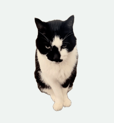
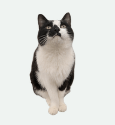
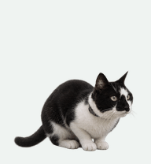
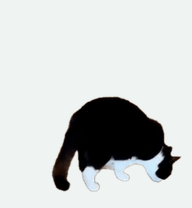
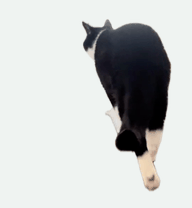
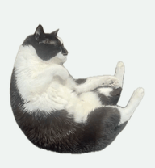
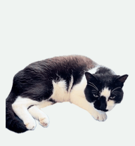
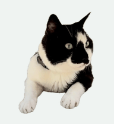
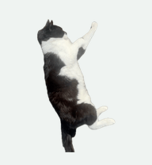
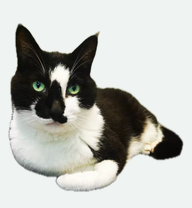

# 黑侠 · Codex 宠物

黑侠是一只真实的黑白短毛猫。这份 Codex v2 宠物包保留了实拍的脸纹、白胸和白爪，支持九个动作状态和十六个指针方向。

  

## 安装

在 macOS 终端运行以下命令，打开 Codex 官方宠物安装窗口。

```sh
open 'codex://pets/install?name=%E9%BB%91%E4%BE%A0&spriteVersionNumber=2&description=%E9%99%AA%E4%BD%A0%E5%86%99%E4%BB%A3%E7%A0%81%E7%9A%84%E9%BB%91%E7%99%BD%E7%9F%AD%E6%AF%9B%E7%8C%AB%E3%80%82&imageUrl=https%3A%2F%2Fraw.githubusercontent.com%2Fzhangmin510%2Fcodex-heixia-pet%2Frefs%2Ftags%2Fv1.0.0%2Fheixia%2Fspritesheet.webp'
```

在窗口中确认安装，到 **设置 → 宠物** 选择「黑侠」。输入 `/pet` 显示桌面宠物。[OpenAI 官方宠物安装链接说明](https://learn.chatgpt.com/docs/reference/commands#pets) · [桌面宠物使用说明](https://learn.chatgpt.com/docs/pets)

也可以[下载 ZIP](https://github.com/zhangmin510/codex-heixia-pet/releases/download/v1.0.0/codex-heixia-pet-v1.0.0.zip)，解压后把整个 `heixia` 文件夹复制到 `~/.codex/pets/`。如果设置了 `CODEX_HOME`，使用其下的 `pets/`。回到 **设置 → 宠物**，点刷新后选择黑侠。

## 动作预览

| 预览 | Codex 状态 | 黑侠的表现 | 素材 |
| --- | --- | --- | --- |
|  | 待机 | 端坐抬眼 | 实拍 |
|  | 向右移动 | 低头向右慢步 | 素材库新增片段 |
|  | 向左移动 | 向左前方巡视 | 实拍 |
|  | 打招呼 | 举白爪擦脸 | 实拍 |
|  | 跳跃 | 蓄力、起跳、腾空、下降、落地 | GPT 图像合成 |
|  | 任务受阻 | 伏低脑袋，安静蜷卧 | 实拍 |
|  | 等待输入 | 趴卧抬眼 | 实拍 |
|  | 任务进行中 | 侧卧伸展 | 实拍 |
|  | 审阅 | 香箱卧姿 | 实拍照片 |
|  | 跟随指针 | 十六个方向，另有正面中立姿态 | 三个方向及中立来自同段实拍，其余方向由 GPT 补齐 |

## 文件与复现

- [heixia/pet.json](heixia/pet.json) 和 [heixia/spritesheet.webp](heixia/spritesheet.webp) 构成宠物包。图集为透明 WebP，1536 × 2288，8 列 11 行，每格 192 × 208。
- [素材说明](source/README.md) 记录实拍来源、合成范围和取帧方式。
- [构建脚本](scripts/build_atlas.py) 从黑侠的透明素材和本仓库已注册的补充帧重新组装图集。需要 Python 3.10+、Pillow 和带 libvpx 的 FFmpeg。

```sh
git clone --depth 1 --branch heixia-v1.1.0 https://github.com/zhangmin510/dsh-heixia-pet.git
python3 -m pip install Pillow
python3 scripts/build_atlas.py --media-dir dsh-heixia-pet/heixia/pet/heixia-animation
```

实拍派生素材与合成帧供个人宠物使用。黑侠原项目与其他平台版本见 [dsh-heixia-pet](https://github.com/zhangmin510/dsh-heixia-pet)。
